---

## 🧠 About me

Software Engineer with 4+ years in QA: functional, regression, mobile and API testing in agile teams.
I automate with **Playwright + TypeScript** (web) and **Maestro / Appium + Python** (mobile), and run everything in CI with GitHub Actions.

- 💬 Ask me about: mobile test automation, API testing and CI pipelines
- 🌍 Based in Colombia 🇨🇴 (UTC-5) · English B2
- 🎓 Software Engineering (UNINPAHU)
- 📫 Open to remote

---

## 🧪 Featured projects

### [qa-automation-portfolio](https://github.com/DavidMC12/qa-automation-portfolio)

One shopping flow (login → catalog → cart → checkout) automated across **web, Android and iOS**.

- 36 end-to-end scenarios (22 web, 14 mobile).
- Playwright + TypeScript with Page Object Model, on Chromium, Firefox and WebKit, plus visual regression.
- Maestro on Android and iOS.
- 5 GitHub Actions workflows; reports with videos and traces on [GitHub Pages](https://davidmc12.github.io/qa-automation-portfolio/).
- Android pipeline cut from 51 to 7 minutes.

### [Cuadre](https://github.com/DavidMC12/Cuadre)

A personal finance web app in real use. Fastify + TypeScript backend, PostgreSQL with Drizzle, Next.js frontend.

- 25+ test files with Vitest against a real database, written to break the money rules (computed balance, transfers that add up).
- 650+ commits since September 2026.

---

## ⚡ Tech stack

**Test automation**

**CI/CD & tools**

**API & performance**

**Built Cuadre with**

Also: Allure · SoapUI · SQL · TestRail · Scrum, SAFe, Shape Up

---

## 🤝 Let's connect

